# xo architecture

One package, two halves: the `xo` command line on your machine, and the xo server (`xo serve`, on
Vercel at `xo.quirq.dev` through `app.py`), which holds the Clerk Secret Key so the CLI never needs
it. Standard library only. Setup is in [quickstart.md](quickstart.md); the server's settings in
[server.md](server.md).

This describes main as of this change: through #56.
Every command has its own sequence diagram in section 3. [architecture.html](architecture.html) is the same doc as a page with drawn diagrams;
GitHub shows it as source, so open it locally or from a static host.

| Mode | Runs on | Holds | Entry point |
|---|---|---|---|
| CLI | your Mac or Linux machine, Python 3.11+ | your XO API key; gh keeps its own login | `xo` = `xo.cli:main` |
| Server | Vercel, Docker, or `xo serve` locally | `CLERK_SECRET_KEY`, in its environment only | `app.py` = `wsgi_app()` |

## 1. System context

The CLI sends your XO key to one address, the xo server. The server answers `/me` and
`/user-metadata` through Clerk, writes your `projects` and `spaces` lists there (and, when you
share, an invite in the other user's `shared`), and passes creates and the space read on to XO's
core API with your key as sent. GitHub is reached through gh and its own login; projects are cloned
with your own git.

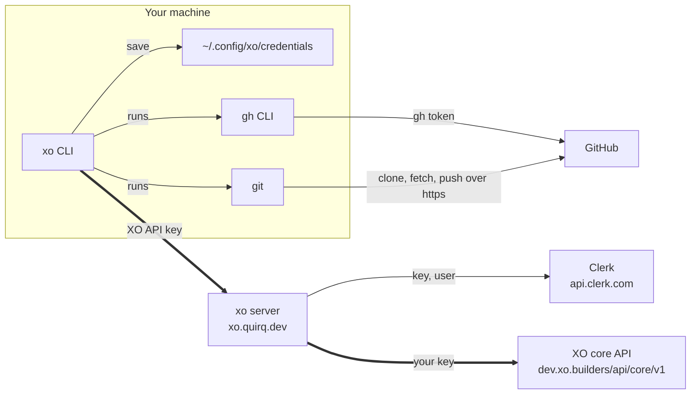

## 2. Commands

Most commands are generated: `commands.register()` reads the bundled spec (`src/xo/openapi.json`,
or `--spec`) and makes one command per operation, with every parameter and body field as a flag.
XO's seven space creates are the exception: they are the kinds of `xo create space NAME KIND`.

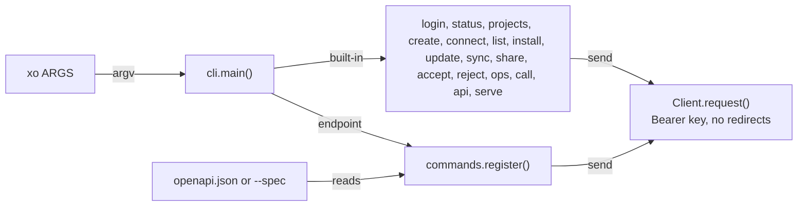

| Command | Goes to | What it does |
|---|---|---|
| `xo create space NAME claude-code --volume-size GB` | server, then XO | a Claude Code space named NAME on XO and in your spaces; add `--providers-anthropic-api-key -` for the Anthropic provider |
| `xo create space NAME codex --volume-size GB` | server, then XO | a Codex space |
| `xo create space NAME antigravity --volume-size GB` | server, then XO | an Antigravity space |
| `xo create space NAME hermes --volume-size GB` | server, then XO | plus a provider key and a Telegram or Slack bot token |
| `xo create space NAME openclaw --volume-size GB --providers-anthropic-api-key K --notification-channels-telegram-bot-token T` | server, then XO | at least one provider key (Anthropic, OpenAI or OpenRouter) and one channel (Telegram, WhatsApp or Slack) |
| `xo create space NAME xo-cowork --volume-size GB` | server, then XO | providers and channels optional |
| `xo create space NAME nebius-openclaw --token-factory-api-key K --telegram-bot-token T` | server, then XO | feature flagged, 404 when off |
| `xo spaces --space-id ID` | server, then XO | `GET /spaces/{spaceId}`: connection URLs with a session token |
| `xo me` | server only | your profile, primary email and both metadata buckets, as `{"xo": {..., "public_data", "private_data"}}`; credential-looking values masked |
| `xo projects [add NAME]` | server only | read or append to the `projects` list in your private metadata |
| `xo create space [NAME]` | git and GitHub, then server | no KIND: the folder's `.git` (this folder, named after itself, or `./NAME`), one branch per git repository under it and an index branch (`main` in a `.git` xo makes, `xo-space` in one already there), pushed to `github.com/OWNER/NAME` or the folder's GitHub origin; then a space entry with nothing on XO (`POST /me/spaces/connect`) |
| `xo create project NAME [URL]` | server, then git | add the project, then clone `OWNER/REPO` into `./REPO` or `git init` a plain name; a NAME given with a URL must be its `REPO` or `OWNER/REPO` |
| `xo connect P S [--ref R]` | server only | set P in space S at R (default `main`) |
| `xo connect P --repo URL` | server, then git | a project made with a name only gets its repo and is recorded as `OWNER/REPO` (refused while P is in a space); `./P` gets that origin only if it has none, and moves to `./REPO` only if its origin is that repo |
| `xo connect S [--id ID]` | server, then XO | record a space entry; `--id` ties it to an XO space your key can read |
| `xo list [projects\|spaces\|shared]` | server only | alone: your projects and spaces in one answer; else show your projects (a GitHub one as `{"name": "headscale", "owner": "juanfont"}`), your spaces, or the invites shared with you (each with an id) |
| `xo spaces` | server only | the same as `xo list spaces`; with `--space-id ID` it is XO's `GET /spaces/{spaceId}` |
| `xo share space:S\|project:P USERNAME` | server only | an invite in that user's `shared`: a space's name and GitHub projects, or one GitHub project |
| `xo accept ID [--as NAME \| --space S [--ref R]] [--yes]` | server only | show the invite and ask, then add a shared space as your own (`--as` renames it), or a shared project to your space S at R |
| `xo reject ID` | server only | take the invite off your `shared`; its sender can share again |
| `xo install project:P\|space:S` | server, git | look P up, then clone, or fetch and fast-forward, it into `./REPO`; for a space, each project into `./S/` at its ref |
| `xo update project:P\|space:S` | server, git | look P up, then push its checkout (never forced); for a space, push each branch, then record the refs under `./S/` |
| `xo sync project:P\|space:S` | server, git | look P up, then `pull --rebase` and push its checkout; for a space, rebase and push each branch, merge refs, record |
| `xo login [xo\|me\|github] [--key]` | server, gh | reads `/config`, gets the key in a browser (or asks for it), checks and saves it, runs gh's login |
| `xo logout`, `xo status` | local, gh | delete saved login; show each service |
| `xo ops`, `xo call`, `xo api` | local / server | list operations; run one by id; send any request |
| `xo serve` | local | run the server on 127.0.0.1:8787 |

Each create row, and each endpoint row (`xo spaces --space-id ID`, `xo me`, and `xo spaces` alone), runs as shown
with `--dry-run` added, which needs no key and sends nothing. XO lowercases space names, so
`xo create space` lowercases NAME before sending it and says so when that changes it.

## 3. Every command, step by step

One swimlane per command: who does each step, in order, and what moves between them. An arrow is a call (`->>`) or its answer (`-->>`): the CLI calls the xo server, git and gh; only the server calls Clerk and XO, and their answers come back through it. A label that starts with "if" is a step that happens only sometimes.

### Log in and check

Setup commands. Only `xo login` sends your key anywhere, and only to the xo server.

#### `xo login`

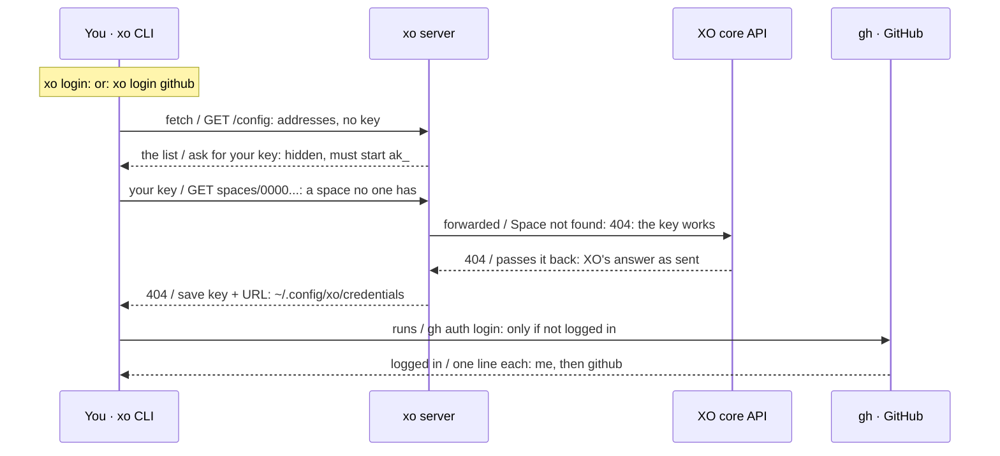

A key is saved only after XO accepts it. A 401, or the server's own bare 404, saves nothing. xo also asks the server's `/me` whose key it is, for the line it prints. Each service prints one line; `xo login xo` (or `me`) or `xo login github` does just that one.

#### `xo login` in a browser

```mermaid
sequenceDiagram
  participant Cli as You · xo CLI
  participant Br as Browser · Clerk sign-in
  participant Srv as xo server
  participant Ck as Clerk
  Note over Cli: xo login: no saved key works
  Cli->>Srv: fetch / GET /login: no key, no Clerk call
  Srv-->>Cli: sign-in address / open the link: challenge, state
  Cli->>Br: browser / you sign in: Clerk's own page
  Br-->>Cli: code / 127.0.0.1 callback: code, if the state matches
  Cli->>Srv: no key / POST /login/browser: code + verifier
  Srv->>Ck: swap / token · userinfo: then your key, or a new one
  Ck-->>Srv: the key / answers the key: once; never logged
  Srv-->>Cli: the key / check + save: as a pasted key is
```

Clerk signs you in; the xo server hands the CLI your key. Only when the server's `GET /login` lists Clerk's sign-in (it does once `XO_OAUTH_CLIENT_ID` and `XO_CLERK_FRONTEND_URL` are set); otherwise, and with `xo login --key`, xo asks for a key as above. The browser comes back to `127.0.0.1` on port 8976, 8977 or 8978 (the first free one). The server swaps the code and the verifier only xo holds at Clerk's `/oauth/token`, reads who signed in at `/oauth/userinfo`, then answers the newest key browser login made that account before (still working with a week or more left, no claims or scopes, so never an admin key; never a key made any other way), or, when it has none or Clerk will not read its secret back, a new one that works for 90 days (at most 5 a day per account). Then xo checks and saves it like a pasted key.

#### `xo logout`

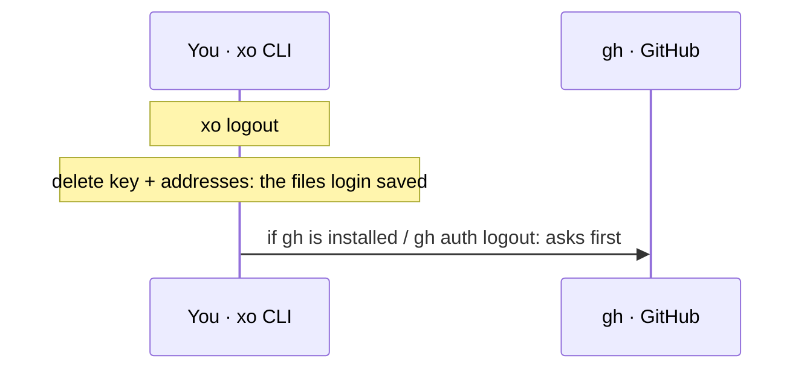

Logout is local first. gh is logged out of github.com only after asking.

#### `xo status`

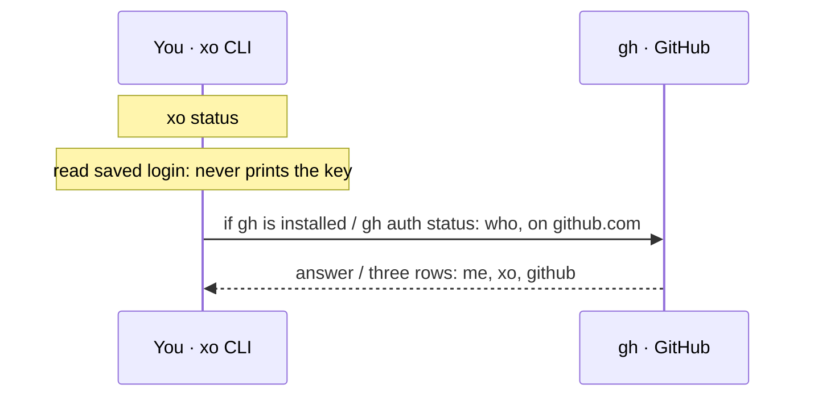

Status sends no key. It only asks the GitHub CLI who it is logged in as.

### Your account

Answered by the xo server itself, with the Clerk Secret Key only it holds.

#### `xo me`

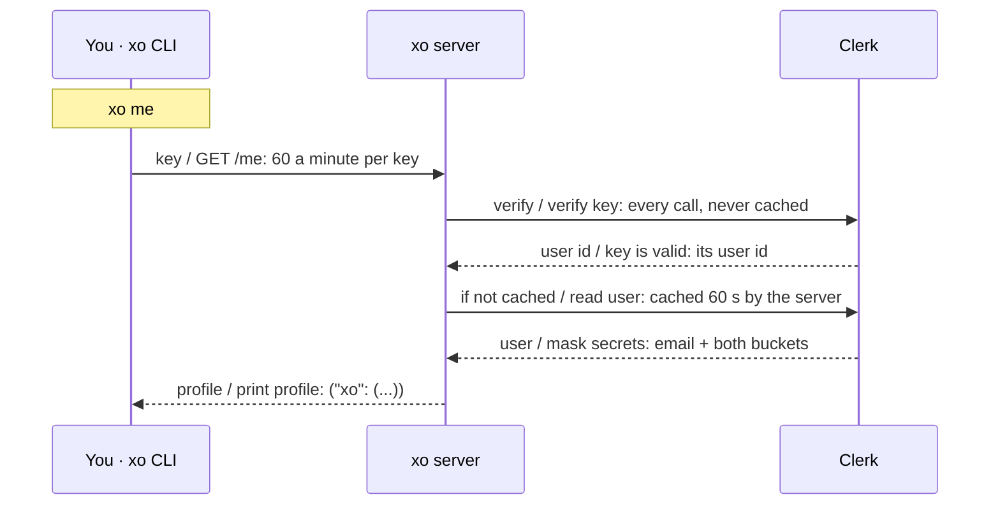

You see your own metadata, masked. Values under credential-like names, or that look like keys, show only their last 4 characters or `(hidden)`. `XO_ME_PRIVATE_KEYS` can narrow the private keys shown.

#### `/user-metadata` (no xo command)

xo has no command for it since `xo me` covers your own profile. The server's admin-only route stays as it was: `GET` and `PATCH /user-metadata/{userId}`, 20 a minute per key, a key with the `xo_admin` claim whose id is in `XO_ADMIN_KEY_IDS`, allow-listed keys only, one audit line per request.

Admin needs two locks, and none is issued yet. Until a key has the claim and its id is listed, every caller gets 403. PATCH changes only top-level keys named in `XO_EDITABLE_*_KEYS`.

### Spaces on XO

Every space on XO is created one way, `xo create space NAME KIND`, and recorded in your spaces. With no KIND, `xo create space NAME` makes the folder it runs in a space on GitHub and records it, with nothing on XO. The old `xo claude-code`, `xo codex`, ... commands are gone and say so.

#### `xo create space NAME KIND`

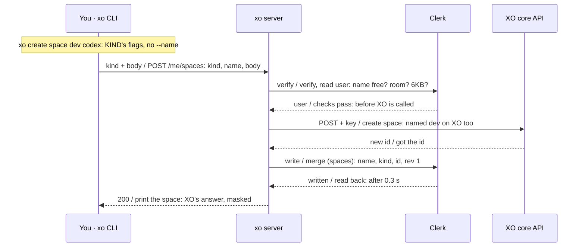

One name, on XO and in your spaces. KIND is `claude-code`, `codex`, `antigravity`, `hermes`, `openclaw`, `xo-cowork` or `nebius-openclaw`; NAME is 1 to 32 letters, digits or hyphens. XO lowercases space names, so xo lowercases NAME before it sends it and says so when that changes it. Everything recording needs is checked before XO is called. Every kind but `nebius-openclaw` stores your key inside the new space, and xo says so first.

#### `xo create space [NAME]`

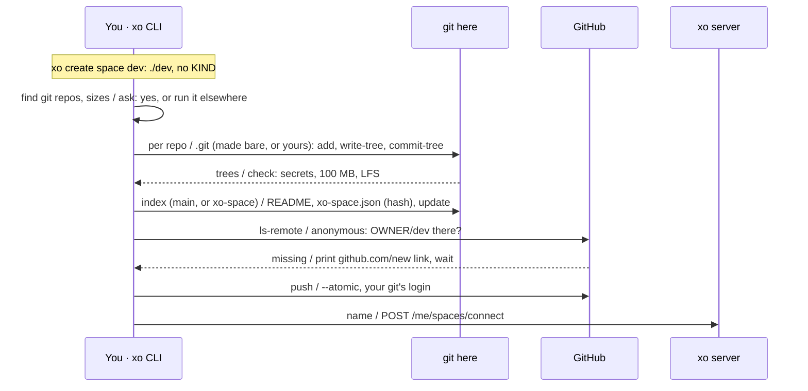

With no NAME the folder `xo create space` runs in becomes the space, named after the folder (or the name its `.git` already records, `xo.space`); with NAME, the folder `./NAME` becomes space NAME, and a missing one is made (an empty space whose index lists no branches until git repositories are put in it; taken away again, still empty, if xo stops before building it; once built, it can be run again as it is, with no repositories yet, say after stopping at the GitHub step) (`src/xo/spacerepo.py`). It is published: the repository is public and xo deletes nothing. Each git repository under it (up to 6 folders down, not one inside another, and not in hidden folders, `node_modules`, `venv` or `__pycache__`; never a folder called `main` or `xo-space`) becomes a branch named by its path, such as `api` or `work/api`; folders that are not repositories and hold none, and files outside the repositories, are left out. xo lists each repository with its size, says where it goes, and asks; `--yes` answers for a script. It refuses your home folder, `/`, folders holding `.ssh`, `.aws` or `.gnupg`, any hidden folder of your home and `~/Library`, a folder inside another git repository (the folder may be one itself) or inside a `.git` folder, a worktree or submodule (`.git` a file), a `sha256` repository, and folder names that differ only in case (also from a branch the space already has) or that git cannot take as branch names.

- With no `./.git`, it is made `--bare` (and marked `xo.space` in its config, so a run that stopped early can run again), so git never checks anything out here and the folder shows no changes, and `main` is the index. A `./.git` that is already a repository with a work tree is attached to: xo marks it `xo.space`, keeps the index on branch `xo-space`, and refuses a repository whose branch name is one of yours here or on GitHub (also the branch checked out with no commit yet, in any case, or inside its name), so your branches, `HEAD`, index and `info/exclude` stay as they were. A branch is xo's only while its tip is a commit xo set it to, as recorded in `.git/xo-space-branches.json` (written before each move, never read from GitHub's copy of the index), it is not checked out in any worktree and it is not a symbolic ref; any other is never moved, deleted or pushed, and every move is checked again right before it (`update-ref --no-deref` with the old value), and GitHub's tips of xo's branches are kept under `refs/xo-space/github/`, not `refs/remotes/origin/`, so your remote-tracking branches stay as they are. Every git call names it with `--git-dir` and `core.hooksPath` set to nothing; a branch is built with `--work-tree REPO` and a scratch index of xo's own (`GIT_INDEX_FILE` in a temporary folder, never the repository's index). In an attached repository xo's exclude list goes in a file of its own (`core.excludesFile`, with your own excludes file's lines added) instead of `info/exclude`. Plumbing only: `add --all`, `update-index --force-remove`, `write-tree`, `commit-tree`, `update-ref` with the old value. Each repository's `.gitignore`, this folder's `.gitignore` (`check-ignore`) and a clone's own `info/exclude` (also for a worktree or submodule, whose `.git` is a file) are followed; `.env` files, keys and credential stores (`NEVER`) are then taken out of the index whatever any `.gitignore` says, at any depth and in any case.
- A repository becomes its files only; a repository nested inside it is dropped (the gitlink), so no history, remote or branch of theirs is touched or pushed; `.github/workflows` is dropped so a pushed branch runs nothing.
- Before anything is committed, xo stops with the file names on a file over 100 MB, a Git LFS pointer, a file a git filter keeps encrypted (git-crypt), a bare repository, or a key, token or password-looking string in any file's bytes (also as UTF-16 text) or name (a Python regex over every blob, read with `cat-file --batch`; if the check fails, nothing is pushed).
- The index (`main`, or `xo-space`) is built with `hash-object` and `mktree -z` from bytes (so Windows' text mode cannot add `\r`): `README.md` with a table of branches, `xo-space.json` (`xo-space/1`: each branch's tree and the sha256 of all of them) and `update`, which runs `xo create space` again in the space's folder. A rerun commits only branches whose tree changed, always on top of origin's branch as GitHub has it now (the anonymous `ls-remote` lists it each run; a commit made here and never pushed is replaced, so nothing left out before the first push is in the history, and a repository deleted and made again gets none of the old history); a folder that is gone keeps its branch as GitHub has it, and one never pushed is dropped.
- The repository is `github.com/OWNER/NAME`, OWNER from `gh api user` or `--owner`; in an attached repository with an origin, it is the GitHub repository that origin is (every fetch and push URL the same `https`, `git@` or `ssh://` GitHub repository with no login in it, else refused without showing the URL; `--owner` must agree), and the origin is left as it is, while one with no origin gets `https://github.com/OWNER/NAME`. Only origin's tracking branches for the space's own branches are made to match GitHub. xo checks it with `git ls-remote` and no login at all (no credential helper, askpass, `.netrc`, extra header or user config, and no redirect), so a private repository looks missing and a renamed or moved one is refused; when it is missing xo prints `https://github.com/new?name=NAME&owner=OWNER&visibility=public` and waits for Enter. Then `git push --atomic` of the exact commits built and checked, as the index and the branches it lists (no other ref, no tags, no hooks), never forced and never redirected, with your own git's login; xo never reads a token.
- Last, once it is pushed, the space entry is recorded (`POST /me/spaces/connect`); a name already in your spaces is fine. Nothing is recorded when nothing was pushed.

#### `xo claude-code | codex | ... (removed)`

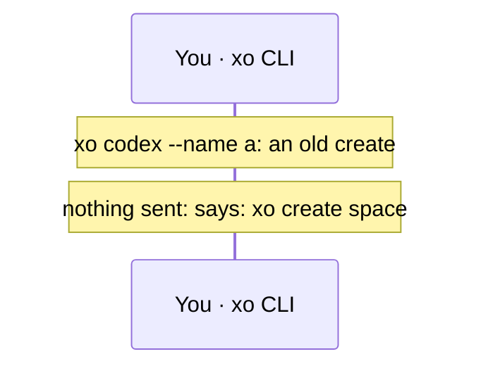

The old creates only point to the new one. xo stops before parsing, so nothing is sent and no flag value is echoed: `xo codex is now xo create space NAME codex [flags]`.

#### `xo spaces --space-id ID`

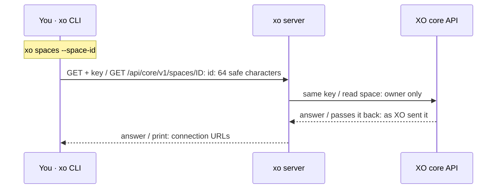

The only way back to a space XO made. The API has no list, delete, start or stop. Treat the URLs as secrets: they carry a session token.

### Projects, spaces and sharing in your metadata

Each write goes through the server's one engine: a per-user lock, a write that names only the keys it changes, a read-back after 0.3 s, up to 3 writes.

#### `xo projects [add NAME]`

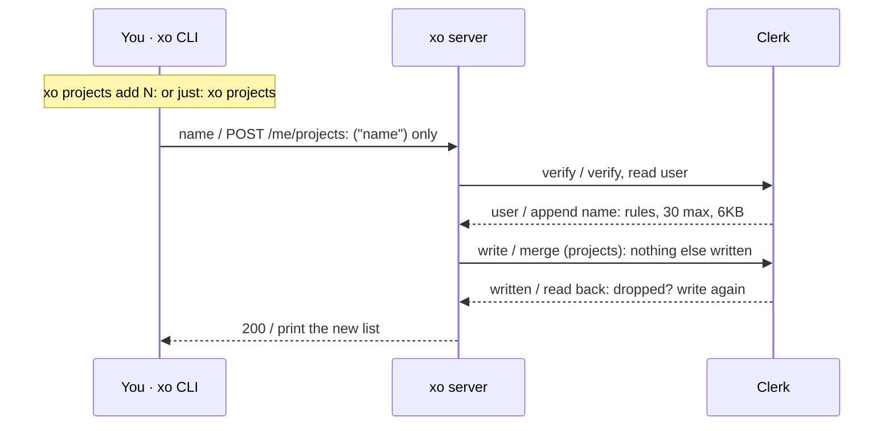

Only the `projects` list changes. A duplicate (ignoring case), a credential-like name, or a full list is refused with nothing written.

#### `xo create project NAME [URL]`

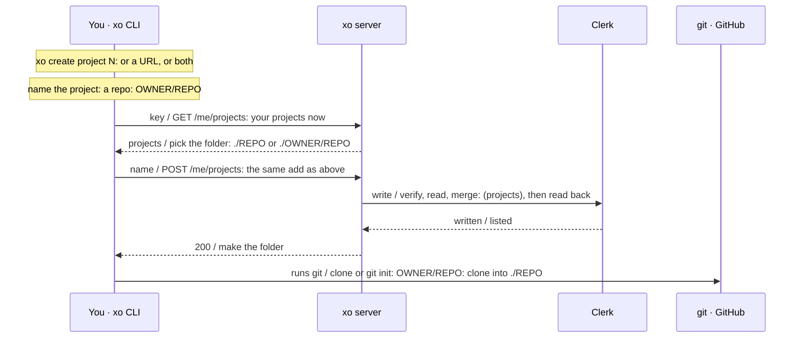

A project is named after its repo. Give a name (`git init ./notes`), a GitHub URL (recorded as `OWNER/REPO`, cloned into `./REPO` and called `REPO` in every command), or both when they name the same repository; a different name with a URL is refused before anything is sent. xo reads your projects first to pick the folder: `./REPO`, or `./OWNER/REPO` when another of your projects is called `REPO` or the repo is called `.xo` (a space's own state folder). Record next, then make the folder; a folder already there is refused before anything is recorded. When two of your projects share a repo name, each is called by its `OWNER/REPO`. A typed name that matches a project exactly wins: a plain project `headscale` is called `headscale`, and `juanfont/headscale` is then called by its `OWNER/REPO`.

#### `xo connect P --repo URL`

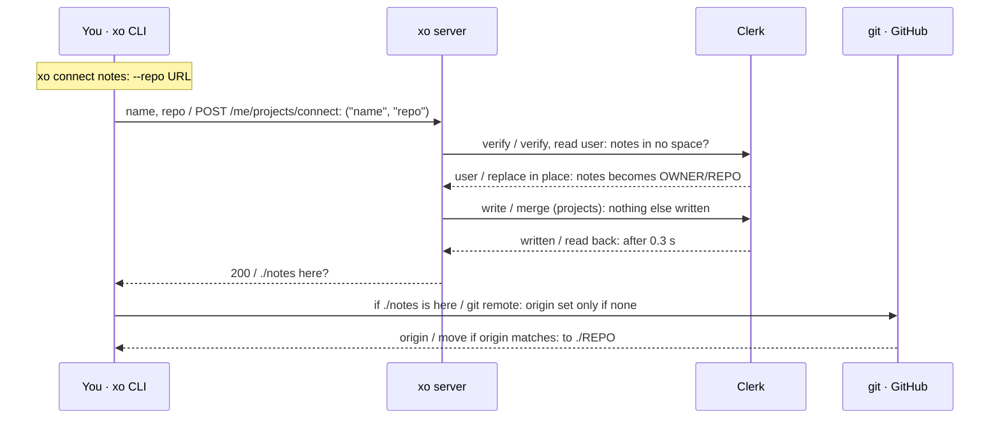

A project made with a name gets its repo later. The name is replaced in place, through the same engine as an add. Refused while the project is in a space, since the space would still name it the old way. If `./notes` is here, it gets the origin only when it has none, and moves to `./REPO` when its origin is that repository (https or git@ form). A folder whose origin xo cannot confirm is that repository (every fetch and push URL) is not moved, and xo says so.

#### `xo connect S [--id ID]`

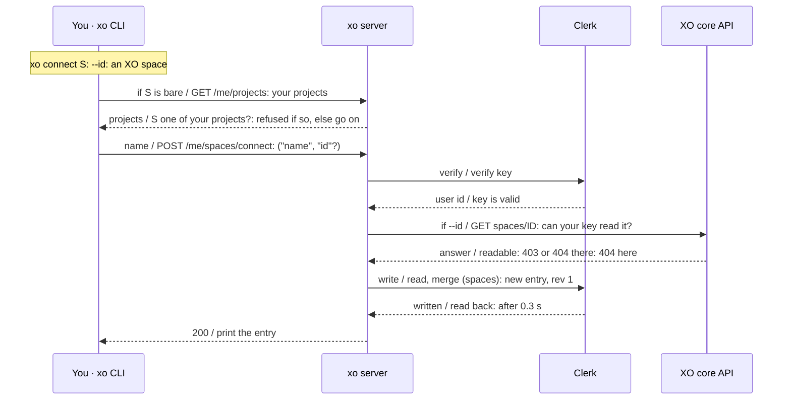

An entry without creating anything. With an id, XO must confirm your key can read that space (403 or 404 there is a 404 here). A name or id already recorded is refused.

#### `xo connect P S [--ref R]`

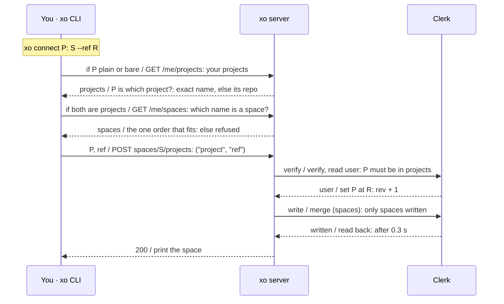

One project, one ref, one more rev. A plain P is looked up in your projects first, so `headscale` sends `juanfont/headscale`. A missing ref is `main`. Connecting P again replaces its ref in place; a space holds at most 10 projects. With bare names, xo reads your projects to tell which name is which: `xo connect headscale test2` and `xo connect test2 headscale` both put headscale in test2, and one name alone is a new space entry unless it is one of your projects. `project:` or `space:` in front still says it outright. When both names are your projects, xo reads your spaces too and takes the one order whose space exists, else refuses.

#### `xo list projects | spaces | shared`

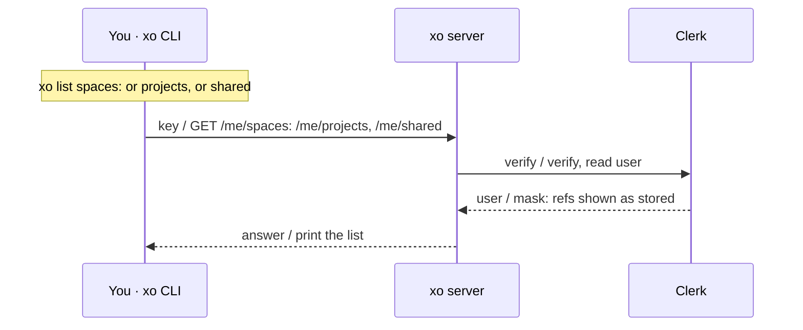

A read, masked as `/me` is. Project names and refs are not masked: a repository called `auth-service` is not a secret. `xo list shared` shows each invite with its id and its sender's username now, which the server looks up in one more Clerk call.

#### `xo share space:S|project:P USERNAME`

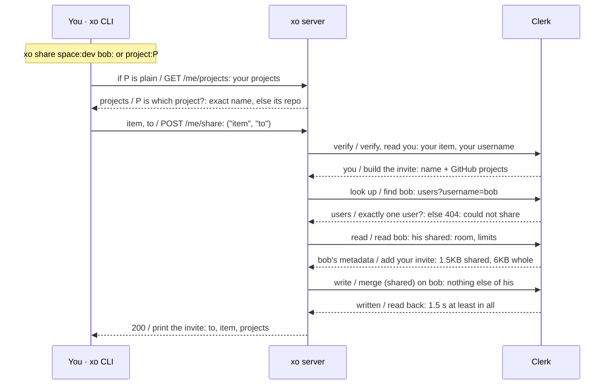

The one write to another user, and only to their `shared`. A plain P is looked up in your projects first, and only a GitHub project can be shared. The invite holds a space's name and its GitHub projects at their refs, never its id, kind or rev; a space's local projects are left out. Everything about the recipient (no such username, a full list, no room) is the same 404 "Could not share ITEM with USERNAME", and every answer takes at least 1.5 seconds. At most 20 invites wait on anyone, 5 from one sender.

#### `xo accept ID · xo reject ID`

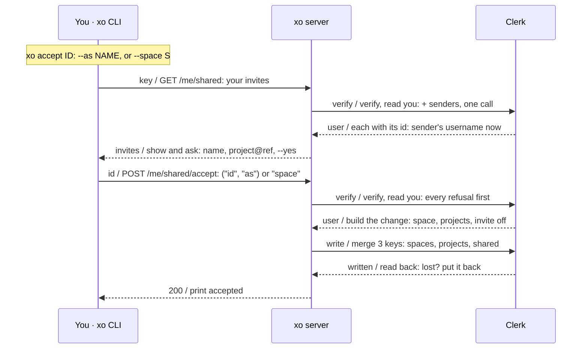

One write of your own metadata, and only when you say yes. A shared space becomes a new space of yours at rev 1 (`--as` names it when its name is taken); a shared project goes into your space `--space S` at `--ref R` (default `main`), and that space's rev goes up by one. Either way its projects are added to your `projects`, and the invite comes off `shared`. `xo reject ID` asks nothing: `POST /me/shared/reject` takes the invite off `shared` and writes nothing else, so its sender can share it again.

### Install, update and sync

Your own git, over https only, with no submodules and none of xo's tokens. The metadata changes only through the server's `PUT /me/spaces/{name}`.

#### `xo install space:S`

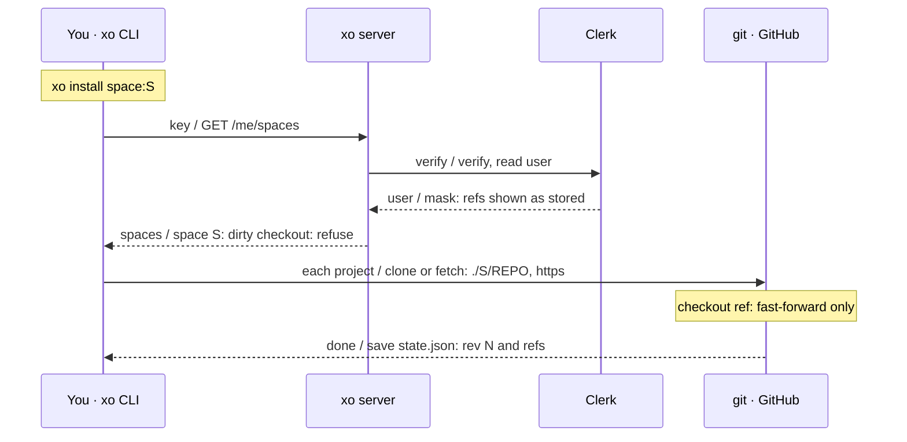

The installed rev and refs are the base for later updates. A project with no GitHub remote is left as it is. A branch that has moved on from its remote is refused, never merged. Each GitHub project goes in `./S/REPO`, or `./S/OWNER/REPO` when another project in the space has that name or it is named like such an OWNER folder (so no folder is inside another), and an existing checkout is used only if its origin is that repo; a plain project's folder is refused when its origin is one of the GitHub projects. `./S/.xo/state.json` is never written through a link, and a `./S/.xo` that is a link or a checkout is refused.

#### `xo install project:P`

```mermaid
sequenceDiagram
  participant Cli as You · xo CLI
  participant Srv as xo server
  participant Clerk as Clerk
  participant Git as git · GitHub
  Note over Cli: xo install project:P
  Cli->>Srv: key / GET /me/projects
  Srv->>Clerk: verify / verify, read user
  Clerk-->>Srv: user / the list
  Srv-->>Cli: projects / P is which project?: ./REPO or ./OWNER/REPO
  Note over Cli: a checkout there?: origin must be P's repo
  Cli->>Git: runs git / clone, or fetch: over https
  Note over Git: fast-forward: never a merge
  Git-->>Cli: done / print: cloned or moved on
```

P is the project a typed name means: an exact match first, else the one GitHub project whose repo is called that (two are refused: say which by `OWNER/REPO`). Its checkout is looked for in `./REPO` and `./OWNER/REPO`, and used only if its origin, every fetch and push URL, is that repo; a folder whose origin is another repo is refused, never fetched. Clone once, then only fast-forward. If your branch and its upstream have both moved on, xo stops and points you to `xo sync project:P`.

#### `xo update space:S`

```mermaid
sequenceDiagram
  participant Cli as You · xo CLI
  participant Srv as xo server
  participant Clerk as Clerk
  participant Git as git · GitHub
  Note over Cli: xo update space:S: reads state.json
  Note over Cli: check checkouts: own, clean
  Cli->>Git: push / git push: each tracked branch
  Git-->>Cli: pushed / read refs here: branch, or commit
  Cli->>Git: fetch / ref on remote?: else refuse
  Git-->>Cli: yes / refs to record: rev N + base
  Cli->>Srv: refs / PUT /me/spaces/S: rev N + base
  Srv->>Clerk: verify / verify, read user: still rev N with base?
  Clerk-->>Srv: user / rev N + 1: else 409: run xo sync
  Srv->>Clerk: write / merge (spaces): rev N + 1
  Clerk-->>Srv: written / read back: after 0.3 s
  Srv-->>Cli: 200 / save state.json
```

Push, then record, only if nobody moved the space. The server refuses with 409 "run xo sync" unless the space is still at rev N and still holds `base`, the refs you installed. With nothing changed, nothing is recorded.

#### `xo update project:P`

```mermaid
sequenceDiagram
  participant Cli as You · xo CLI
  participant Srv as xo server
  participant Git as git · GitHub
  Note over Cli: xo update project:P
  Cli->>Srv: key / GET /me/projects
  Srv-->>Cli: projects / P is which project?: its checkout here?
  Note over Cli: origin is P's repo?: else refuse
  Cli->>Git: push / push to upstream: never forced
  Git-->>Cli: done / pushed: remote ahead: xo sync
```

P is looked up in your projects as for install, and needs a checkout here whose origin is P's repo; one whose origin is another repo is refused, never pushed. A plain push, never forced. It goes to the branch's upstream remote, not a `pushRemote`, and needs a branch, not a detached HEAD.

#### `xo sync space:S`

```mermaid
sequenceDiagram
  participant Cli as You · xo CLI
  participant Srv as xo server
  participant Clerk as Clerk
  participant Git as git · GitHub
  Note over Cli: xo sync space:S: reads state.json
  Cli->>Git: rebase / pull --rebase, push: each tracked branch
  Git-->>Cli: pushed / read refs here
  Cli->>Srv: read space / GET /me/spaces
  Srv->>Clerk: verify / verify, read user
  Clerk-->>Srv: user / the space
  Srv-->>Cli: space S / merge refs: installed, yours, space
  Cli->>Git: no clash / checkout merged: where the space moved
  Git-->>Cli: done / save state.json: the space as read
  Cli->>Srv: refs / PUT /me/spaces/S: only if refs changed
  Srv->>Clerk: write / verify, read, merge: (spaces), then read back
  Clerk-->>Srv: written / rev + 1
  Srv-->>Cli: 200 / save state.json
```

A three-way merge of refs, per project. If you and the space both changed one project, or the space's rev went back, it stops, names the projects and records nothing. A rebase that conflicts is undone and left for you.

#### `xo sync project:P`

```mermaid
sequenceDiagram
  participant Cli as You · xo CLI
  participant Srv as xo server
  participant Git as git · GitHub
  Note over Cli: xo sync project:P
  Cli->>Srv: key / GET /me/projects
  Srv-->>Cli: projects / P is which project?: its checkout here?
  Note over Cli: origin is P's repo?: else refuse
  Cli->>Git: rebase / pull --rebase: undone on conflict
  Note over Git: push: never forced
  Git-->>Cli: done / print: rebased, pushed
```

P and its checkout are found as for update. Rebase on the upstream, then push. On a conflict xo runs `git rebase --abort`, so the checkout is as it was.

### Lower level

For operations the generated commands don't cover, or to see what a command would send.

#### `xo ops [FILTER]`

```mermaid
sequenceDiagram
  participant Cli as You · xo CLI
  Note over Cli: xo ops codex
  Note over Cli: read openapi.json: or --spec, XO_SPEC
  Note over Cli: print operations: id, method, path
```

Offline. The spec is read from disk, never fetched, so `ops` and every `--help` work without a network.

#### `xo call OPERATION · xo api METHOD PATH`

```mermaid
sequenceDiagram
  participant Cli as You · xo CLI
  participant Srv as xo server
  participant Xo as XO core API
  Note over Cli: xo call create_codex: --param, --data, --field
  Cli->>Srv: request + key / /api/core/v1/...: creates + space read only
  Srv->>Xo: forwarded / XO's answer
  Xo-->>Srv: answer / passes it back: as XO sent it
  Srv-->>Cli: answer / print JSON: secrets redacted
```

Anything else gets the server's 404. To reach XO directly, add `--url https://dev.xo.builders` with `XO_API_KEY` or `--api-key -`. `--dry-run` sends nothing and hides provider keys.

### Run the server

`xo serve` runs the same server on your machine.

#### `xo serve`

```mermaid
sequenceDiagram
  participant Cli as You · xo CLI
  participant Srv as xo server
  Note over Cli: xo serve: --host, --port
  Cli->>Srv: start / ThreadingHTTPServer: 127.0.0.1:8787
```

The same App Vercel runs. It needs `CLERK_SECRET_KEY` in its environment and listens on localhost by default; anything else should sit behind HTTPS.

## 4. The server

```mermaid
flowchart LR
  wsgi["wsgi_app() (Vercel)"] -- WSGI --> app["App.handle()"]
  http["ThreadingHTTPServer (xo serve)"] -- HTTP --> app
  app -- public --> pub["/, /status, /healthz, /config, /login"]
  app -- key --> acct["/me, /me/projects, /me/spaces/**, /me/share, /me/shared/**, /user-metadata"] -- verify --> clerk[Clerk]
  app == forward ==> fwd["/api/core/v1/..."] == your key ==> core[XO core API]
  app -- "code + verifier" --> login["/login/browser"] -- "swap, then your key" --> clerk
```

`POST /login/browser` needs no key: it swaps a browser sign-in's code with Clerk and answers that account's key (one it has, else a new one), so it spends the Secret Key too.

## 5. Projects, spaces and invites in your metadata

A normal key changes three keys of Clerk private metadata. On its own user it writes `projects` and
`spaces`, and `shared` when it accepts or rejects an invite; accept writes `shared`, `projects` and
`spaces` in one merge. The one write to another user is a share: `POST /me/share` adds the caller's
invite to the recipient's `shared`, and writes nothing else of theirs. The client sends a name,
kind, id, project and ref, item and username, or invite id, never metadata; the server builds every
change and writes through one engine, `App._change()` and `App._change_keys()`.

```
projects: ["quirq-ai/xo", "notes"]            OWNER/REPO is cloned into ./REPO; a plain name gets git init (max 30)
spaces:   [{"name": "dev", "kind": "claude-code", "id": "<XO space id>", "rev": 2,
            "projects": [{"quirq-ai/xo": "main"}, {"notes": "v1.2"}]}]   (max 10, 10 projects each)
shared:   [{"from": "<user id>", "fromName": "alice", "item": "space:dev",
            "projects": [{"quirq-ai/xo": "main"}], "at": "<time>"}]   (max 20, 5 per sender, 1.5KB)
./S/.xo/state.json (on your machine): {"space", "rev", "projects"} as installed
```

Each space's project keys must be in `projects`. All three share one 8KB Clerk bucket with XO's own
keys, so xo stops writing when the whole private metadata, `shared` (the invites) included, would
pass 6KB; `shared` itself is capped at 1.5KB and one invite at 1KB, so others can take at most 1.5KB
of anyone's room.

```mermaid
sequenceDiagram
  participant CLI as xo projects add / create / connect / update / share / accept
  participant S as xo server
  participant C as Clerk
  CLI->>S: POST or PUT /me/projects, /me/spaces/**, /me/share, /me/shared/** (names, refs, ids only)
  S->>S: verify key, rate limit, validate with names.py and the 6KB budget
  S->>S: one change per user written to (lock, this instance)
  loop up to 3 writes, stop after 10 s
    S->>C: GET /users/{id}
    S->>C: PATCH metadata naming only the keys it changes
    S->>S: wait 0.3 s
    S->>C: read back: anything dropped by a racing write?
  end
  S-->>CLI: 200 with the new list, 409 if someone else changed the space, or 503
```

| Route | Command | Change |
|---|---|---|
| `POST /me/projects` | `xo projects add`, `xo create project` | append a name |
| `POST /me/projects/connect` | `xo connect P --repo URL` | replace a plain name with its `OWNER/REPO`, in place; refused while P is in a space |
| `POST /me/spaces` | `xo create space` | check name and budget, create on XO with your key, record `{name, kind, id, rev: 1}` |
| `POST /me/spaces/connect` | `xo connect S [--id]`, `xo create space NAME` (no KIND) | new entry; with an id, only after XO confirms your key can read it |
| `POST /me/spaces/{name}/projects` | `xo connect P S` | set one project's ref |
| `PUT /me/spaces/{name}` | `xo update`, `xo sync` | replace projects and refs if the space is still at `rev` holding `base`, else 409 "run xo sync" |
| `GET /me/projects`, `GET /me/spaces` | `xo projects`, `xo list`; `GET /me/projects` also for `xo create project`, `xo install`, `xo update` and `xo sync project:P`, a plain P in `xo share` and `xo connect` (with or without `project:`), and in `xo connect` a bare name alone or beside another bare name (not `[project:]NAME --repo` or a project-shaped name alone, which send none); `GET /me/spaces` also for `xo connect` when both names are your projects | read, masked as `/me` is (refs shown as stored) |
| `POST /me/share` | `xo share` | `{item, to}`: the caller's invite into user `to`'s `shared`, and nothing else of theirs; anything about the recipient is the same 404 |
| `GET /me/shared` | `xo list shared`, `xo accept` | the caller's invites, each with an id and its sender's username now |
| `POST /me/shared/accept` | `xo accept` | `{id, as?}` or `{id, space, ref?}`: one write of `spaces`, `projects` and `shared` (the invite off) |
| `POST /me/shared/reject` | `xo reject` | `{id}`: the invite off `shared`, nothing else |

## 6. Install, update and sync

A new `workspace.py` drives `gitops.py`. The metadata is only changed by the server, through
`PUT /me/spaces/{name}`.

```mermaid
flowchart LR
  meta[space S in metadata<br/>rev N, project: ref]
  local[./S/REPO<br/>./S/.xo/state.json]
  meta -- read --> install[xo install space:S] -- clone, checkout, save rev N --> local
  local -- push, read refs --> update[xo update space:S] -- PUT rev N + base, 409 if moved --> meta
  meta <-- read, then PUT --> sync[xo sync space:S] <-- rebase, push, checkout --> local
```

- `xo update` pushes each tracked branch first; `xo sync` rebases each on its upstream and pushes it,
  undoing a rebase that conflicts. Tags and commits stay where they are.
- `xo sync` keeps the space's change, or yours, per project, and stops on a project both changed
  (or one the space dropped while you changed it).
- A ref is recorded only if it is on the project's remote; a checkout with uncommitted changes is never touched.
- Single projects: xo looks P up in your projects (`GET /me/projects`), then uses git: install clones,
  or fetches and fast-forwards; update pushes (never forced); sync runs `pull --rebase` then pushes.
  An existing checkout is used only if its origin is P's repo.
- git runs with `GIT_ALLOW_PROTOCOL=https`, no submodules, `--end-of-options` before names and refs, and without XO, Clerk or gh tokens in its environment.
- Two updates on different instances that both read rev N within the 0.3 s settle can both get 200;
  the later write stands and the other client's next update is refused, since the space no longer
  holds its `base`. If a stale write sends the rev backwards, `xo sync` stops and names the projects
  that differ.

## 7. Access model

- `client.py` is the only CLI code that talks to XO, and also reads qq-setup's `pins.json` for auto-update; `gitops.py` runs git, `github.py` runs gh and `selfupdate.py` runs pip. `Clerk` and `Core` in `server.py` are the only server code that talks out.
- The key is never printed, and is redacted in escaped forms too. Plain `http://` is refused except to this machine.
- `/me` returns your own email and both metadata buckets, with credential-like values masked;
  `XO_ME_PRIVATE_KEYS` can narrow the private keys it shows.
- A normal key writes only `projects`, `spaces` and `shared` on its own user (accept writes all three in
  one merge), and one thing on another user: its own invite in their `shared` (`xo share`). Every
  change is one audit line (a count, never a value; a share names the recipient only by a hash).
- An admin key needs the claim `xo_admin: true` and an id in `XO_ADMIN_KEY_IDS`. None is issued yet.

| Secret | Lives in | Sent to |
|---|---|---|
| XO API key | `~/.config/xo/credentials` or `XO_API_KEY` | the server it was saved with, which forwards it (also for `xo create space` and `connect --id`); copied into each new space except `nebius-openclaw` |
| `CLERK_SECRET_KEY` | the server's environment | `api.clerk.com` |
| GitHub token | gh's store or your git credential helper | github.com over https; xo never reads it |

## 8. Where state lives

No database. Clerk: your `projects`, `spaces` and `shared` (invites waiting on you) in private
metadata. CLI: `credentials` and
`services` under `$XDG_CONFIG_HOME/xo/`, and `./S/.xo/state.json` per installed space.
Package: `services.json` (served at `/config`) and `openapi.json`. Server: process memory only
(last 100 requests, rate limits for up to 10,000 keys, `/me` cache for 60 seconds, one change lock
per user), plus audit lines on stderr.

## 9. Folder map

41 tracked files.

```
src/xo/
  cli.py            CLI    argparse; built-ins: login, status, projects, create, connect, list,
                           install, update, sync, share, accept, reject
  workspace.py      CLI    install, update, sync
  gitops.py         CLI    the user's git: https only, own checkouts, no submodules, no xo tokens
  client.py         CLI    the only XO network code, saved key, redaction
  commands.py       CLI    spec operations to commands and flags
  spec.py           CLI    load and check the OpenAPI spec
  github.py         CLI    gh login, status, logout
  selfupdate.py     CLI    auto-update (off unless qq-setup's marker): daily background check, pip update
  names.py          shared project, space and ref rules; the only module both sides import
  services.py/.json shared services list and saved addresses
  openapi.json      shared bundled core API spec
  server.py         server App, Clerk, Core forward, /me masking, write engine, sharing, limits
  status_page.py    server status page, CSP pinned by hash
app.py              server Vercel entry
Dockerfile          server non-root image running xo serve
tests/              shared pytest on loopback: fake XO, fake Clerk, local git remotes
                           (test_workspace.py drives install, update and sync)
docs/               shared guides and the server test script
```
